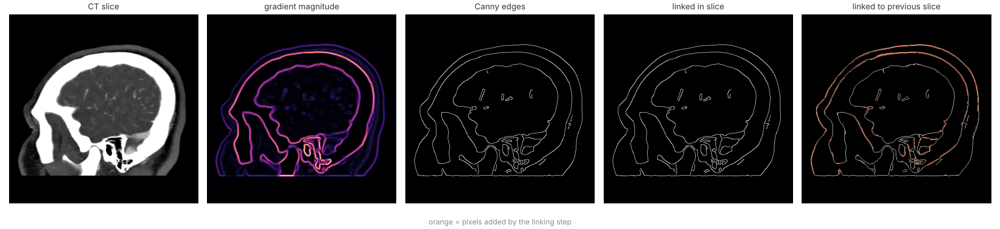
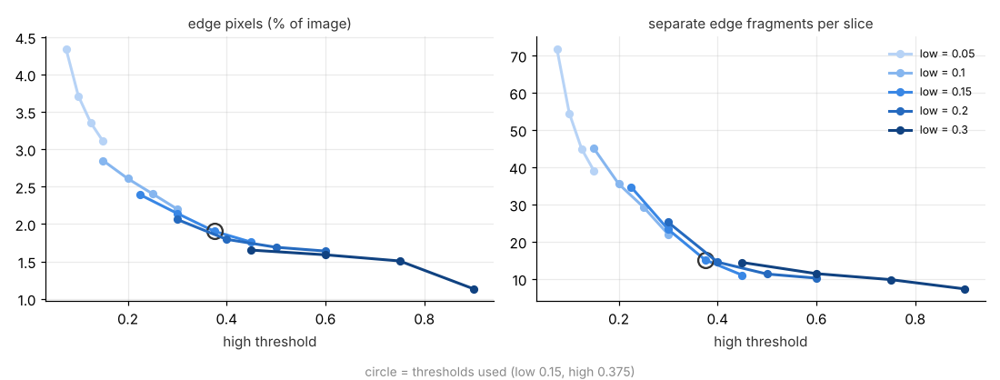
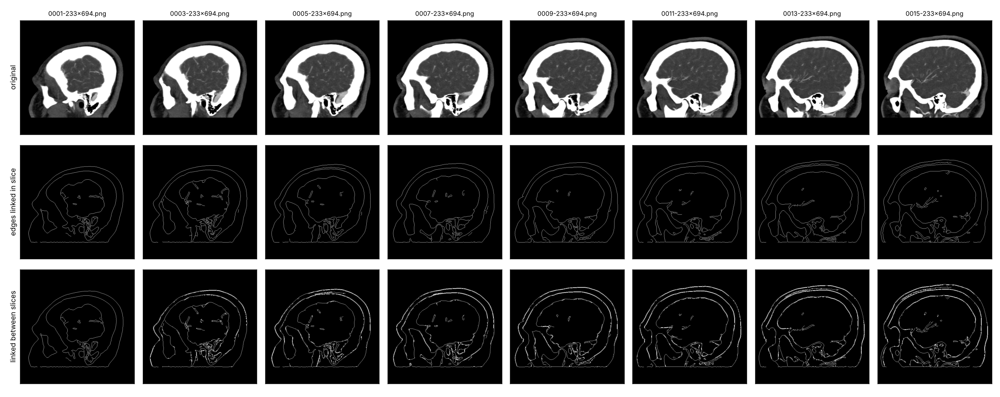
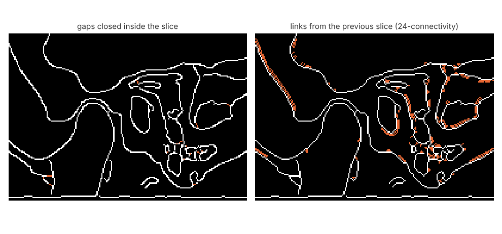

# Edge detection in 3D CT with inter-slice linking

Finds contours of organs and bones in a stack of CT slices. Each slice goes
through a Canny edge detector written out step by step, gaps are closed inside the
slice, and then edges are linked between neighbouring slices with
24-connectivity, so a contour that breaks up in one slice gets support from
the one before it.



## How it works

1. **Canny** (`ctedges/canny.py`): Gaussian smoothing (σ = 1.4), Sobel
   gradients, non-maximum suppression in four directions, then double
   threshold with hysteresis. Thresholds are absolute gradient values on the
   image scaled to [0, 1]: **low 0.15, high 0.375**.
2. **Linking inside a slice** (`ctedges/linking2d.py`): uses only the binary edge
   map, with no gradient magnitude or angle. Edges are thinned to one pixel. Every open end
   is then extended with a straight line to the nearest edge pixel that is at most
   6 px away and lies roughly in front of it (within about 60° of the
   direction the edge was going). The target has to be another fragment or the
   other open end of the same one, so a contour can close on itself.
   Fragments shorter than 10 px are dropped at the end.
3. **Linking between slices** (`ctedges/linking3d.py`): for each edge pixel
   (x, y) in slice n, look at slice n+1. If there is an edge at (x, y) or in its
   3×3 neighbourhood, nothing happens. If the 3×3 is empty but the 5×5 is not,
   every edge pixel (x+a, y+b) of that 5×5 is connected back to (x, y) by
   stepping a and b towards 0 by one each step, and every pixel along the
   way is set to 1 in slice n+1.

The three steps are separate functions, so each can be tested and switched
off on its own.

## Choosing the thresholds

There is no ground truth for edges in this data, so I picked the thresholds by
sweeping a grid and looking at the result together with the images
(`scripts/sweep_thresholds.py`).



With a high threshold below ~0.3 the detector picks up small vessels inside the brain
and texture in the soft tissue, and the number of fragments climbs quickly.
Above ~0.4 both curves flatten: what is left are the skin, skull, brain surface
and the sinuses, which is what I wanted. The low threshold mostly decides how
far a contour is followed into weaker parts. I took the point at the start
of the flat part, low 0.15 and high 0.375 (ratio 2.5). If you want vessels, use
`--low 0.1 --high 0.25`.

## Results

Test data: 20 consecutive sagittal head slices (512×512) of one patient from
CTMRI DB, series `233x694`. Numbers are averages over slices.

| step | edge pixels | fragments | open ends |
|---|---:|---:|---:|
| Canny | 6258 | 41.8 | 81* |
| + linking inside slice | 4988 | 15.1 | 43.8 |
| + linking between slices | 8351 | – | – |

\* counted after thinning to one pixel, so it compares fairly with the next row.

* **Linking inside a slice** joins most of the broken pieces. With fragment
  removal switched off, linking alone brings fragments from 41.8 to 17.4 and open
  ends from 81 to 47. The pixel count goes down because thinning removes the
  places where non-maximum suppression leaves 2 px wide ridges.
* **Between slices**, 79 % of edge pixels already have an edge in the previous slice
  within the 5×5 window, but only 48 % within 3×3. The slices are far enough apart
  that most contours move by 1–2 px from slice to slice, so the
  24-connectivity step adds a lot: about 3400 pixels per slice (+70 %).
* The whole pipeline takes about 1 s for 20 slices.



The rows are the original slices, after linking inside each slice, and after
linking between slices. This is the same view `scripts/detect.py --show` opens.



### Second block of slices

To check that the thresholds were not just tuned to one part of the head, I ran
the same settings without changes on six other consecutive slices of the same
series (0048–0053), from a different part of the head with more
structures in each slice.

| | slices 0001–0020 | slices 0048–0053 |
|---|---:|---:|
| fragments after Canny | 41.8 | 81.0 |
| fragments after linking inside slice | 15.1 | 30.2 |
| edge pixels within 3×3 of previous slice | 48 % | 81 % |
| pixels added by linking between slices | +70 % | +21 % |
| same as `cv2.Canny` (exact) | 99.7 % | 99.6 % |

The edge maps look as clean as on the first block. Contours here change less
from slice to slice, so the 24-connectivity step has much less to add.

### Checking the Canny implementation

Since everything is written by hand, I compared the edges with OpenCV's
`cv2.Canny` on the same smoothed images and with the same thresholds. 99.7 % of
pixels are identical and 99.9 % match within 1 px. The remaining differences are
ties in non-maximum suppression. The same comparison is a unit test
(`tests/test_canny.py`).

The first version of this code had three bugs that this check exposed. Hysteresis
never added weak pixels, the thresholds were computed on a different scale than
the one they were compared against, and the two diagonal cases in non-maximum
suppression were swapped (y points down in an image). Together they meant that it
kept only about 45 % of the edges OpenCV finds with the same thresholds.

## What doesn't work well

* **The 24-connectivity rule thickens contours that move.** When a contour shifts
  by 2 px between slices, every pixel of it in slice n draws short paths into
  slice n+1. The result is a band 2–3 px wide instead of a line (visible on the
  skull in the zoom above). For 3D surfaces this is fine. For clean 2D
  contours it would be better to thin again afterwards or to link only to the
  closest pixel instead of all of them.
* **The linking only looks one slice back**, so a contour missing in two slices
  in a row is not recovered.
* **Bottom of the field of view.** Where the scan ends (bottom of every image),
  the edge of the image itself becomes a strong straight edge.
* **Fixed thresholds** work here because all slices come from one series with the
  same window. A different series or a different window would need a new sweep.
* No ground truth, so all numbers above describe the edge maps, not how
  accurate the contours are.

## Usage

```bash
pip install -r requirements.txt

# a list of consecutive slices, in order
python scripts/detect.py data/233x694 0001-233x694.png 0002-233x694.png 0003-233x694.png --show

# every slice in the folder
python scripts/detect.py data/233x694 --all --out output

python scripts/sweep_thresholds.py data/233x694
python scripts/make_figures.py data/233x694
pytest -q
```

Output is one binary .png per input slice (after linking between slices),
with the same file name.

## Data

The images come from CTMRI DB (Laboratory for Biomedical Computer Systems and
Imaging, University of Ljubljana). They are not included in this repository.
Put a folder of consecutive slices into `data/`, e.g.
`data/233x694/0001-233x694.png ...`.

## Layout

```
ctedges/
  canny.py       smoothing, gradients, NMS, hysteresis
  linking2d.py   closing gaps inside a slice
  linking3d.py   24-connectivity linking between slices
  pipeline.py    the three steps together
  metrics.py     edge density, fragments, open ends, slice agreement
  viz.py         sequence plots and overlays
scripts/         detect, threshold sweep, figures
tests/
results/         threshold sweep and per-slice numbers
figures/
```

---

The first version of this was a lab assignment for a biomedical imaging
course at the Faculty of Computer and Information Science, University of
Ljubljana. I've kept working on it since.

Licensed under MIT.
